<div align="center">

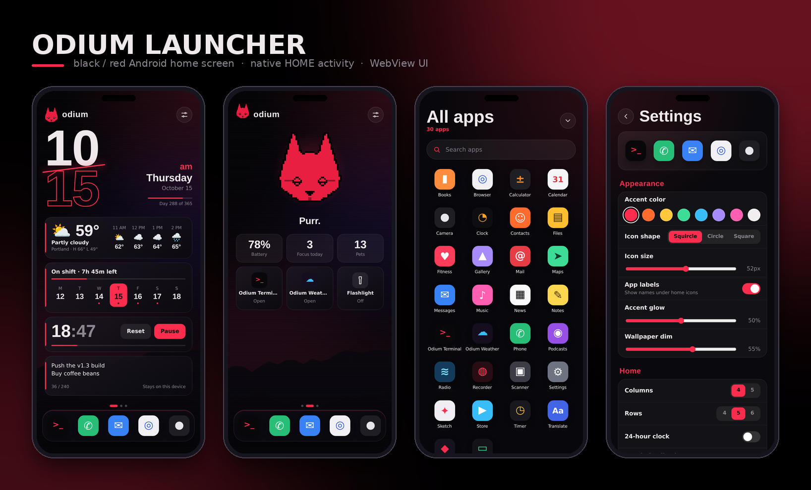

# Odium Launcher

**A black-and-red Android home screen with a big clock, a pixel cat, and a very fast app drawer.**
Native `HOME` activity. The whole UI is HTML/CSS/JS in a WebView.


[Install](#install) · [Tour](#tour) · [Gestures](#gestures) · [Settings](#settings-reference) · [Build](#build) · [How it works](#how-it-works) · [Changelog](#changelog)

</div>

---

## Highlights

- **Dashboard first.** Stacked outline clock with a slash through it, weather, shift countdown, week strip, focus timer and a quick note, all on one page.
- **Instant drawer.** Swipe up, type, press Enter. The first match launches.
- **Your home, your pages.** Dock of 5, auto-paginated app pages, long-press anything to pin, hide, inspect or uninstall.
- **A cat that lives here.** Blinks, follows your finger, falls asleep at night and locks in during focus sessions.
- **Fully themeable.** 8 accent colors, 3 icon shapes, adjustable icon size, glow and wallpaper dim, 4/5 columns, 4/5/6 rows.
- **Uses your wallpaper.** The WebView is transparent, so your system wallpaper shows through under a dark scrim with a faint accent glow.
- **Small and private.** One permission (`INTERNET`, for weather). No analytics, no accounts, everything else stays on the device.

## Tour

> Previews are rendered from the real UI code with a mocked Android bridge and placeholder apps, at a 412 × 915 viewport.

### Home pages

Swipe sideways: **Dashboard → Odium → App pages**. The dots above the dock show where you are.

<table>
<tr>
<td align="center" width="33%">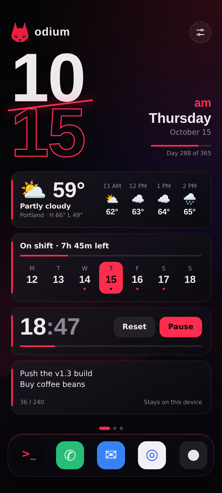<br><b>Dashboard</b><br><sub>Clock, weather, shift, week strip, focus timer, note</sub></td>
<td align="center" width="33%">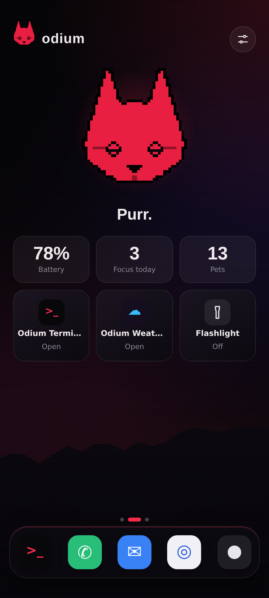<br><b>Odium page</b><br><sub>Cat, battery, stats, quick tiles</sub></td>
<td align="center" width="33%">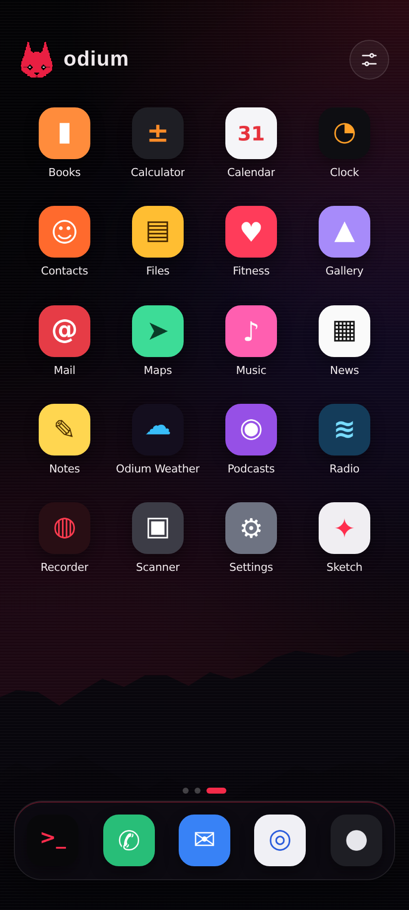<br><b>App pages</b><br><sub>Your pinned apps, paged automatically</sub></td>
</tr>
</table>

### Drawer, menus and settings

<table>
<tr>
<td align="center" width="25%">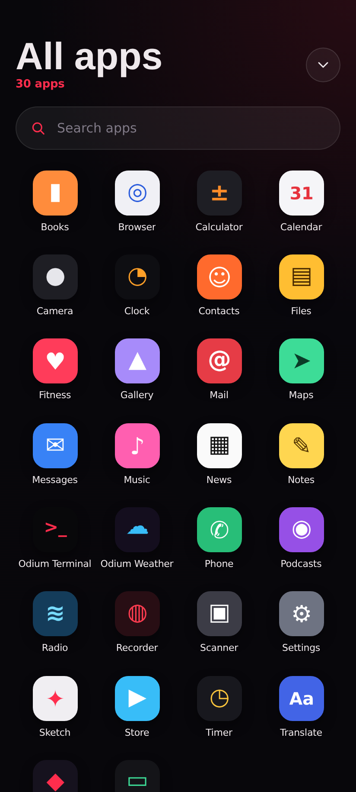<br><b>All apps</b><br><sub>Swipe up from home</sub></td>
<td align="center" width="25%">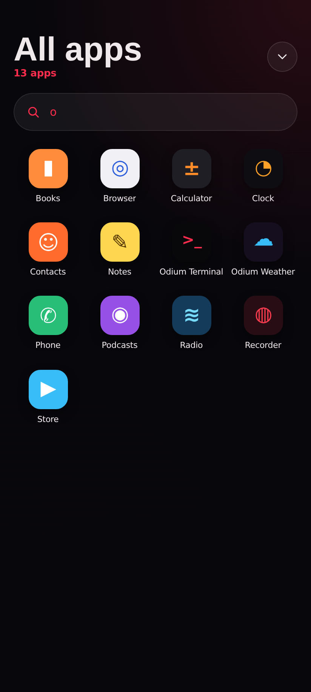<br><b>Instant search</b><br><sub>Enter launches the first result</sub></td>
<td align="center" width="25%">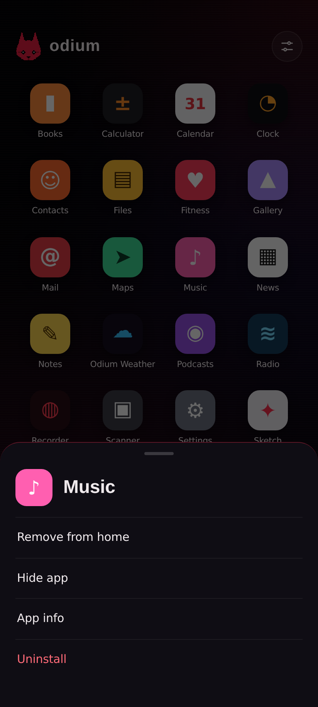<br><b>App menu</b><br><sub>Long-press any icon</sub></td>
<td align="center" width="25%">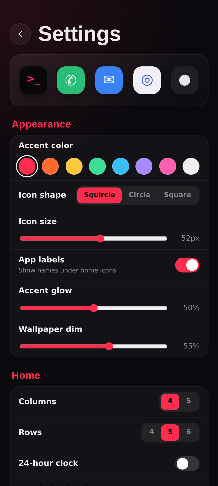<br><b>Settings</b><br><sub>Gear icon or long-press empty home</sub></td>
</tr>
</table>

<details>
<summary><b>More settings screens</b></summary>
<br>
<table>
<tr>
<td align="center" width="50%">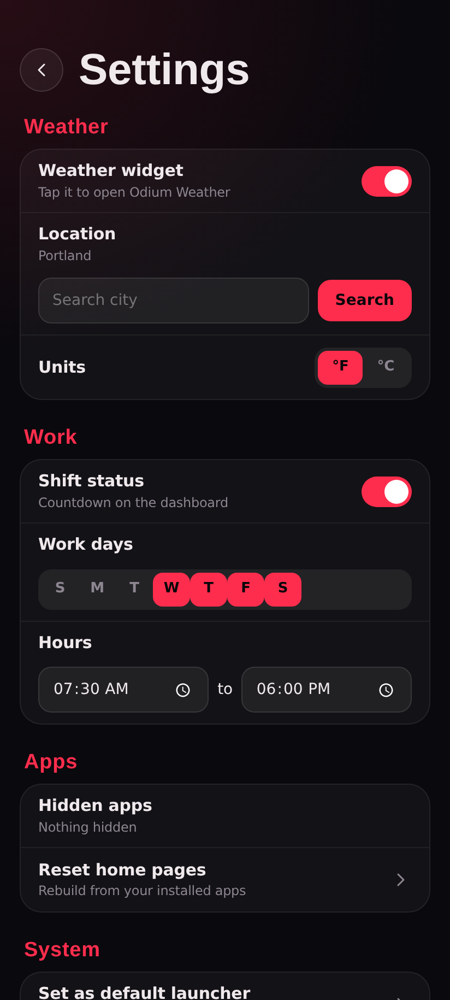<br><sub>Weather and Work</sub></td>
<td align="center" width="50%">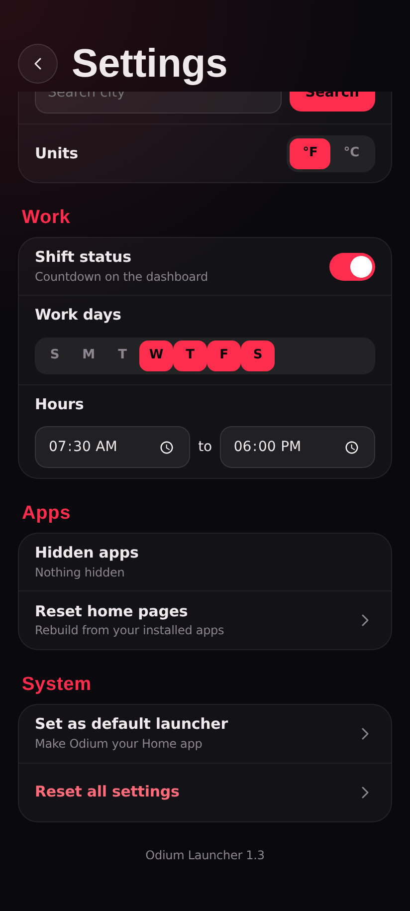<br><sub>Apps and System</sub></td>
</tr>
</table>
</details>

### Make it yours

Same launcher, four looks. Left to right: default red squircles, cyan circles with more glow, green squares at a larger size with heavier dim, violet circles with a 5-column grid and no labels.

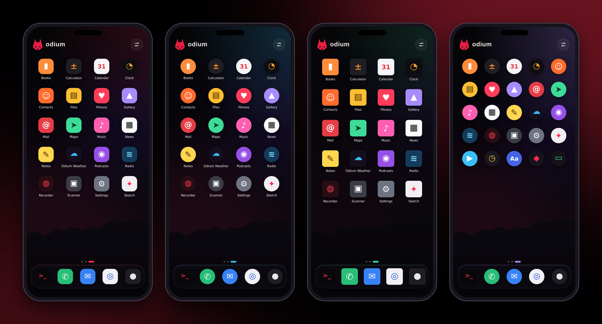

## The Odium page

Swipe from the dashboard to the next page to meet the cat.

- **Mood follows the clock and your focus sessions.** Awake by day, drowsy before 09:00 and after 21:00, asleep from 23:00 to 06:00, and locked in while a focus timer is running.
- **Eyes follow your finger.** They blink on their own and reset to center after a couple of seconds.
- **Tap to pet.** Each pet is counted, optionally with haptic feedback.
- **Stats row:** battery level (and charging state), focus sessions finished today, total pets.
- **Quick tiles:** Odium Terminal and Odium Weather (greyed out as *Not installed* if their packages are missing) plus a flashlight toggle.

## Dashboard widgets

| Widget | What it does | Configure in |
|---|---|---|
| Clock and date | Stacked outline clock, am/pm marker, weekday, date, and a "Day N of 365" year progress bar | Home > 24-hour clock |
| Weather | Current conditions, today's high/low, next four hours. Powered by [Open-Meteo](https://open-meteo.com/), no API key. Cached for 15 minutes. Tap to open Odium Weather. | Weather |
| Shift status | Countdown to start or end of shift, a progress bar while you are on shift, "next shift" text on days off, work days marked on the week strip | Work |
| Week strip | Monday-first week with today highlighted | Home > Week strip |
| Focus timer | 15 / 25 / 45 / 60 minute sessions with start, pause, resume and reset. Finished sessions are counted per day. | Home > Focus length |
| Quick note | 240 characters, saved locally, never leaves the device | Home > Quick note |

Every widget can be switched off. On screens shorter than 820 px the quick note is hidden to keep the dock clear.

## Gestures

| Do this | Where | Result |
|---|---|---|
| Swipe up | Home | Open the app drawer |
| Swipe down | Drawer (scrolled to top) | Close the drawer |
| Type, then **Enter** | Drawer search | Launch the first result |
| Tap | Any icon | Launch the app |
| Long-press (about 0.5 s) | Any icon | Add to or remove from dock and home, hide, app info, uninstall |
| Long-press | Empty home area | Open settings |
| Swipe left / right | Home | Move between Dashboard, Odium and app pages |
| Press **Home** | Anywhere | Close everything and jump back to the dashboard |
| Press **Back** | Anywhere | Close the top layer (menu, settings, drawer), then return to the first page. The launcher never exits. |

The dock holds up to 5 apps. Hidden apps disappear from the drawer, home pages and dock, and can be restored under **Settings > Apps**.

## Install

1. Get the APK from the [Actions](../../actions) tab (**Build Launcher APK** > latest run > `odium-launcher-apk`), or [build it yourself](#build).
2. Allow installs from your browser or file manager if Android asks, then install the APK.
3. Press **Home** and choose **Odium Launcher > Always**. You can also open **Settings > System > Set as default launcher** inside the app.

With ADB:

```bash
adb install -r app/build/outputs/apk/debug/app-debug.apk
adb shell cmd package set-home-activity com.odium.launcher/.LauncherActivity
```

**Going back:** Android Settings > Apps > Default apps > Home app, then pick your old launcher.

**First run:** the dock is filled with Odium Terminal (if `com.odium.terminal` is installed), then your default dialer, messaging app, browser and camera, up to 5. Home pages are filled from your remaining apps in alphabetical order. Use **Settings > Apps > Reset home pages** to rebuild them after installing a lot of new apps.

## Settings reference

Open with the gear icon or by long-pressing empty home space. The preview strip at the top shows your current dock with the icon shape and size you picked.

| Section | Options |
|---|---|
| **Appearance** | Accent color (`#ff2d4d` `#ff6a2d` `#ffc83d` `#3ddc97` `#38bdf8` `#a78bfa` `#ff5fb0` `#f2eef0`), icon shape (squircle / circle / square), icon size 40-62 px, app labels, accent glow 0-100%, wallpaper dim 0-90% |
| **Home** | Columns 4 or 5, rows 4 / 5 / 6, 24-hour clock, haptic feedback, week strip, focus timer, focus length, quick note |
| **Weather** | Widget on/off, city search (Open-Meteo geocoding), units in °F or °C |
| **Work** | Shift status on/off, work days (default Wed-Sat), hours (default 07:30-18:00) |
| **Apps** | Hidden apps list with one-tap unhide, reset home pages |
| **System** | Set as default launcher, reset all settings (asks you to tap twice) |

## Build

**Easiest:** push this folder to GitHub as the repo root. The workflow in `.github/workflows/build.yml` runs on every push to `main` / `master` (or manually from the Actions tab) and uploads the APK as the `odium-launcher-apk` artifact.

**Locally:**

```bash
# needs JDK 17 and the Android SDK (platform 34, build-tools 34.0.0)
./gradlew assembleDebug        # or: gradle assembleDebug  (Gradle 8.9)
# -> app/build/outputs/apk/debug/app-debug.apk
```

| | |
|---|---|
| Package | `com.odium.launcher` |
| `minSdk` / `targetSdk` / `compileSdk` | 26 / 28 / 34 |
| Language | Java 17 for the shell, plain HTML/CSS/JS for the UI. No frameworks, no bundler, no npm. |
| Orientation | Portrait only |
| Permissions | `INTERNET` |

`targetSdk 28` is deliberate: it keeps package visibility open so the launcher can list every installed app without a `<queries>` block.

## How it works

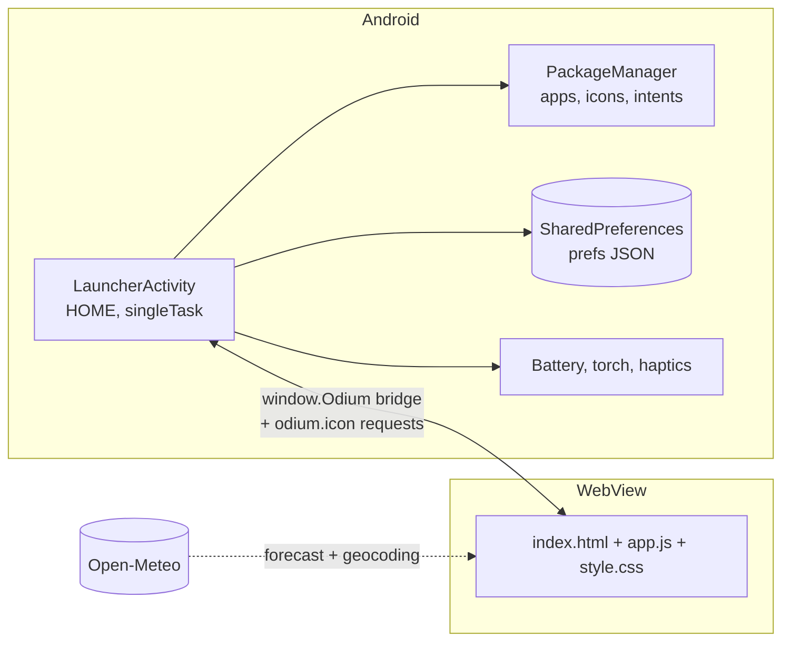

`LauncherActivity` is a transparent full-screen WebView registered for `MAIN` / `HOME`. Everything you see is `assets/index.html`, `app.js` and `style.css`.

**JavaScript to native** (`window.Odium`):

| Method | Purpose |
|---|---|
| `apps()` | Launchable activities as JSON (`package/Activity` id plus label), excluding the launcher itself |
| `defaultDock()` | First-run dock: Odium Terminal, dialer, messaging, browser, camera |
| `launch(id)` / `appInfo(id)` / `uninstall(id)` | Start the app, open its system info page, start the uninstall flow |
| `chooseLauncher()` | Open Android's default Home app settings |
| `battery()` | `{level, charging}` for the Odium page |
| `torch(on)` | Flashlight through the Camera2 torch API (no camera permission needed) |
| `haptic()` | Long-press vibration |
| `getPrefs()` / `setPrefs(json)` | Persist all settings, the quick note and counters |

**Native to JavaScript:** `odiumApps()` (package added, removed or changed), `odiumHome()` (Home pressed while visible), `odiumBack()` (Back pressed), `odiumInsets(top, bottom)` (status and navigation bar sizes).

**Icons** are rendered natively at 144 px, cached in a 300-entry LRU, and served to the page through an intercepted `https://odium.icon/?id=...` URL, so the page can use them in ordinary `` tags.

**Privacy:** the only network calls are the Open-Meteo forecast and city search, and only if you set a weather location. Settings, notes, pet counts and focus counts live in the app's private storage. `allowBackup` is off.

### Project layout

```text
.
├── .github/workflows/build.yml     CI: builds the debug APK
├── app/
│   ├── build.gradle
│   └── src/main/
│       ├── AndroidManifest.xml     HOME intent filter, INTERNET
│       ├── java/com/odium/launcher/
│       │   └── LauncherActivity.java   WebView host and JS bridge
│       ├── assets/
│       │   ├── index.html          Layout: pager, dock, drawer, settings
│       │   ├── app.js              All behavior and state
│       │   ├── style.css           Theme (accent, glow, scrim all CSS variables)
│       │   └── cat.png             Pixel cat sprite
│       └── res/                    Launcher icons and theme
├── docs/screenshots/               README previews
└── gradle/wrapper/
```

### Hacking on it

- Colors, glow, icon size and corner radius are CSS variables (`--accent`, `--glow`, `--is`, `--ir`, `--scrim`) set from your settings in `applyPrefs()`.
- All defaults live in one `DEF` object at the top of `app.js`. Add a setting by adding a key there and a row in the `SET` table.
- The UI only needs a `window.Odium` object with the methods above, so you can iterate in a desktop browser by stubbing it, then rebuild the APK once.

## Not included (yet)

Landscape mode, folders, icon packs, notification badges, and hosting Android widgets. The dashboard widgets are built into the launcher instead.

## Troubleshooting

| Problem | Fix |
|---|---|
| Pressing Home opens another launcher | Choose Odium Launcher > **Always**, or use Settings > System > Set as default launcher |
| Want the old launcher back | Android Settings > Apps > Default apps > Home app |
| Weather says *Set your weather location* | Settings > Weather > search for your city and tap **Use** |
| Weather stuck on *Loading* | It needs a network connection and refreshes every 15 minutes. Changing units forces a refresh. |
| Odium Terminal / Weather tiles say *Not installed* | They look for `com.odium.terminal` and `com.odium.weather` |
| Home pages look empty or out of date | Settings > Apps > **Reset home pages** |
| Something is badly off | Settings > System > **Reset all settings** (tap twice) |

## Changelog

<details open>
<summary><b>v1.3</b>: weather and shift status</summary>

- Weather widget (Open-Meteo, no API key): current conditions, today's high/low and the next hours. Set your city in Settings > Weather. Tap it to open Odium Weather. Adds the `INTERNET` permission.
- Shift status on the dashboard: countdown to start or end of shift, progress bar, work days marked on the week strip. Configure days and hours in Settings > Work.
</details>

<details>
<summary><b>v1.2</b>: the cat and the Odium page</summary>

- Pixel cat in the header and on a new Odium page: blinks, follows your finger, tap to pet. Mood follows the time of day and focus sessions.
- Odium page: battery, focus sessions today, pets, quick tiles for Odium Terminal, Odium Weather and a flashlight toggle.
- Optional haptic feedback (Settings > Home).
</details>

<details>
<summary><b>v1.1</b>: pages and full-screen settings</summary>

- Swipeable home pages: a dashboard page (stacked clock, week strip, focus timer, quick note) plus app pages with a page indicator.
- Long-press any app: add/remove from home pages, dock, hide, info, uninstall.
- Full-screen settings: accent, icon shape and size, labels, glow, wallpaper dim, grid size, 24-hour clock, widget toggles, focus length, hidden apps, resets.
</details>

<details>
<summary><b>v1.0</b>: first release</summary>

- Native HOME activity with a WebView UI in the Odium black/red style.
- Big clock and date, 5-app dock, swipe-up drawer with instant search, long-press app actions.
- Shows the system wallpaper, dimmed. Accent color, 4/5-column grid and hidden apps.
</details>

---

<div align="center"><sub>odium · black, red, and a cat</sub></div>
